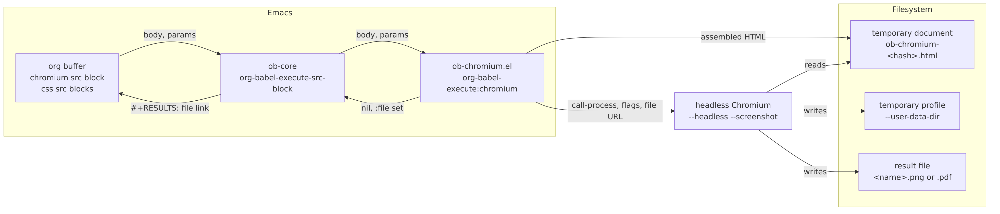
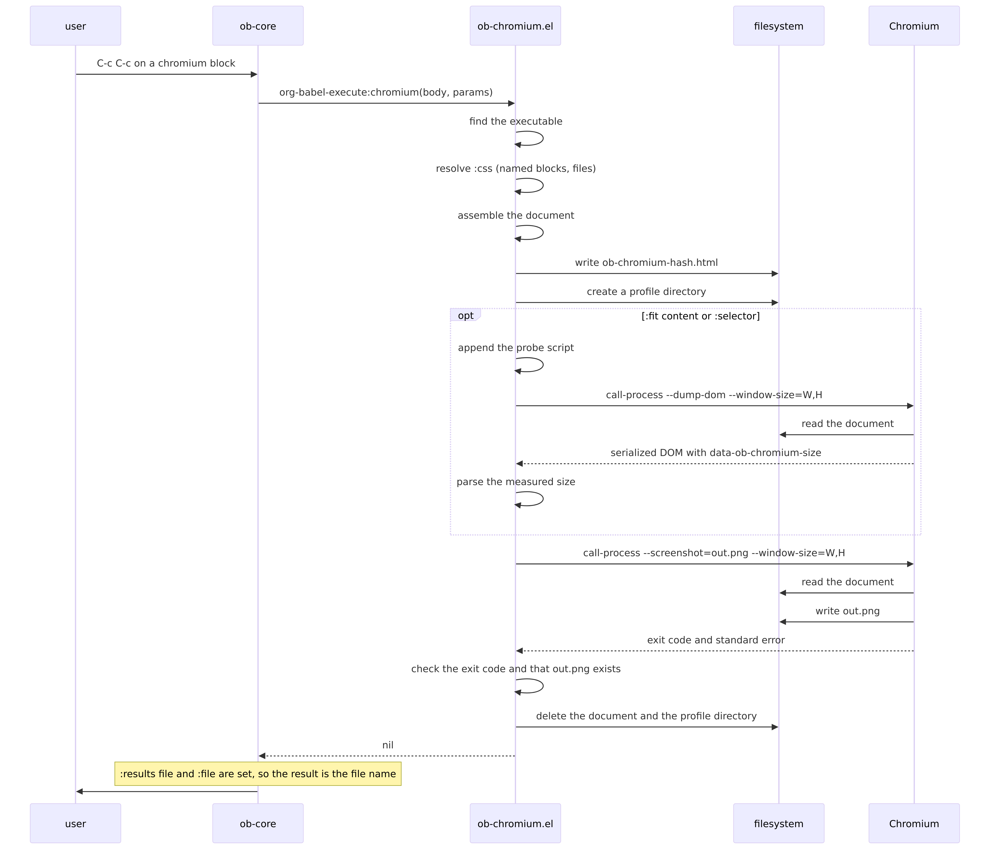
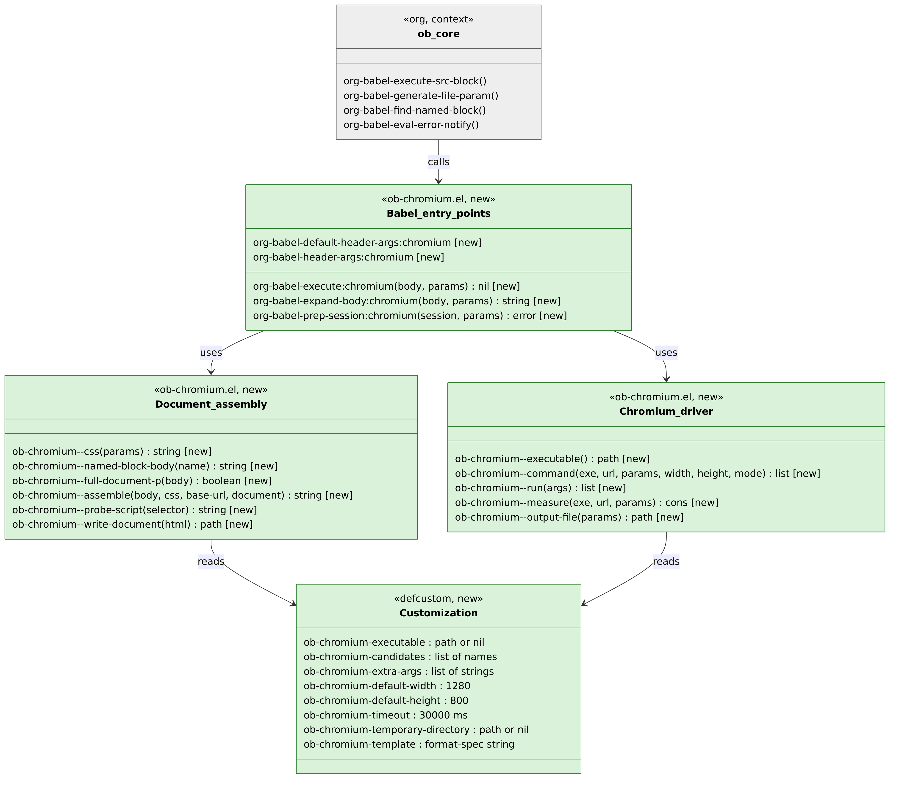
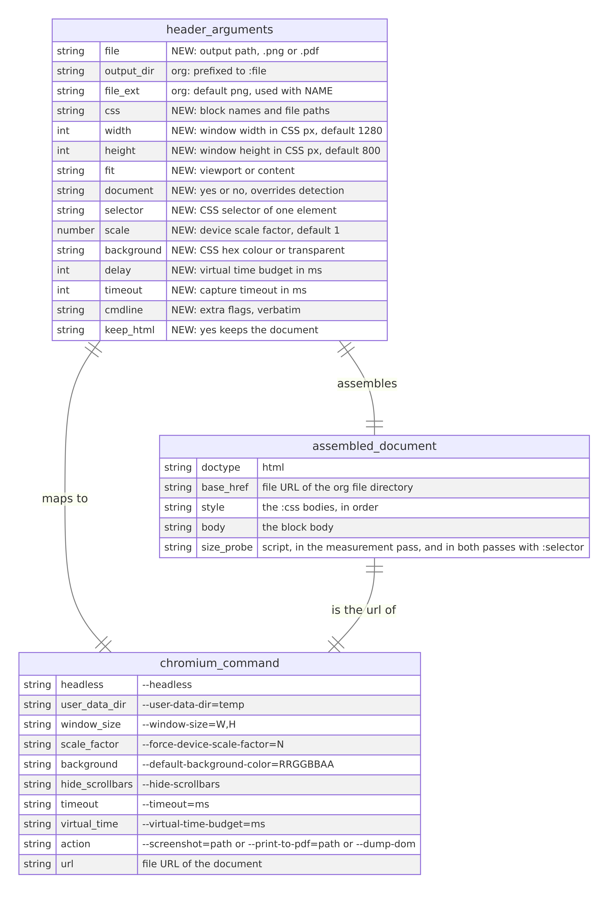

#+TITLE: An org-babel language that renders HTML and CSS to a screenshot with headless Chromium
#+DATE: 2026-10-16
#+STATUS: Implemented and tagged =0.1.0= on 2026-10-16. Open questions 1-14 were decided on 2026-10-16; questions 4 and 10 went against the recommendation. Work plan steps 1-11 are done, except that the MELPA recipe of step 10 is not submitted because the repository has no remote yet. Open questions 15 and 16, raised during implementation, carry the choices the code makes and are to be decided. All checks pass in a Docker container with Emacs 29.4 and Chromium 155; nothing has run on a Mac or on another Emacs version yet. See Progress.
#+OPTIONS: toc:2 num:nil ^:nil
#+HTML_HEAD: <link rel="stylesheet" href="file:///Users/jamesgornet/Dropbox/GitHub/orgcss/build/org.css"/>

* Progress

As of 2026-10-16. Step numbers are those of the Work plan. Every
commit is on =main= in this repository, tag =0.1.0= at =24e3a32=.

| Step | What                                                    | State                                              |
|------+---------------------------------------------------------+----------------------------------------------------|
| 0    | This design document                                    | Done, =372a21a=                                      |
| 1    | Package skeleton                                        | Done, =95b8831=                                      |
| 2    | =ob-chromium--executable=, =ob-chromium--run=               | Done, =bf53057=                                      |
| 3    | Document assembly, =:css=, =org-babel-expand-body:chromium= | Done, =ed12436=                                      |
| 3a   | =:document= override                                      | Done, =d6444d5=                                      |
| 4    | =org-babel-execute:chromium=, viewport mode               | Done, =32015be=                                      |
| 5    | =:fit content=                                            | Done, =de6581b=                                      |
| 5a   | =:selector=                                               | Done, =a2852e0=                                      |
| 6    | PDF output                                              | Done, =ea120ea=                                      |
| 7a   | =--disable-infobars=                                      | Done, =de95c41=. Added during step 7, see below      |
| 7    | =test-example.org=, =test-init.el=, =dev-test.sh=             | Done, =7b02f1d=                                      |
| 8    | CI, lint                                                | Done, =8f894ea=. Not yet run on GitHub               |
| 9    | =README.org=                                              | Done, =24e3a32=                                      |
| 10   | Tag =0.1.0=, MELPA recipe                                 | Tagged. Recipe not submitted: no remote repository |
| 11   | Measurement                                             | Done, see Measurement, Results                     |

** Pull requests

None. The repository has no remote. Every step is a commit on =main=.

** What has been verified

| Check                                                    | Where                                        | Result                                               |
|----------------------------------------------------------+----------------------------------------------+------------------------------------------------------|
| =dev-test.sh syntax=, byte-compile with warnings as errors | Docker, Emacs 29.4                           | Pass                                                 |
| =dev-test.sh lint=, =checkdoc= and =package-lint=              | Docker, Emacs 29.4                           | Pass                                                 |
| =dev-test.sh unit=, 44 ERT tests, 12 of them integration   | Docker, Emacs 29.4, org 9.6.15, Chromium 155 | 44 pass                                              |
| =dev-test.sh batch=, 13 blocks of =test-example.org=         | Docker, as above                             | 13 rendered. The PNGs were read and show the content |
| Window sizes 50 to 1280 px wide, 50 to 2000 px tall      | Docker, Chromium 155 directly                | Painted in full with =--disable-infobars=              |
| Measurement, 10 runs per case                            | Docker, as above                             | See Results                                          |

Not verified: Emacs 27.2, 28.2 and 30.1, macOS, Windows, Chrome or
Brave or Edge as the browser, =chrome-headless-shell=, a snap
Chromium, an interactive session with inline images, and export. The
CI workflow is written but has not run, because the repository has
no GitHub remote. The container has no sandbox, so every run there
used =--no-sandbox= through =ob-chromium-extra-args=.

** Where the code differs from the design

- The selector probe script isolates the element when the script
  runs, at the end of =<body>=, and measures on the load event. The
  design had both on the load event. The capture run then shows the
  isolated element whatever the order of the load handlers. The
  Element capture section is updated to the code.
- The command line carries =--disable-infobars=, which the design
  did not have (open question 15).
- The output file is deleted before Chromium runs, so a failed run
  cannot leave a stale image that passes the existence check. The
  design did not say so. Added to Running Chromium and reporting
  errors.
- Error messages start with a capital letter and have no
  =ob-chromium:= prefix, because =checkdoc= requires it.
- The temporary directory falls back to =temporary-file-directory=
  when org has none, which org 9.3 to 9.5 in batch mode do not. The
  design assumed org always has one. Added to Where the temporary
  files go and Edge cases.

* Summary

=ob-chromium= is an Emacs package that adds the =chromium= language to
org-babel. A =chromium= source block holds HTML. The block can name
CSS source blocks or CSS files in a =:css= header argument. When the
user executes the block, the package assembles one HTML document from
the body and the CSS, writes the document to a temporary file, starts
headless Chromium on that file with =--screenshot=, and inserts a
=file:= link to the PNG as the block's result. The PNG shows inline in
the org buffer and exports with the document.

The package is one Elisp file with no dependency outside Emacs and
org. It needs a Chromium family browser on the machine. It runs
Chromium once per block with =call-process= and a fresh profile
directory, so a running browser does not interfere (open questions 2
and 8).

All 14 open questions were decided on 2026-10-16. Twelve follow the
recommendation. Two do not. The package detects a full document from
its first tag and the user can override the detection with
=:document yes= or =:document no= (open question 4). The user can
capture one element with =:selector=, which the package measures and
isolates with a script before the screenshot (open question 10).

* Background

** What exists today

=ob-mermaid= (https://github.com/arnm/ob-mermaid) is the reference
for this design. It is one file, =ob-mermaid.el=. It defines
=org-babel-default-header-args:mermaid= as =:results file= and
=:exports results=, reads each header argument from =params=, builds
one shell command string for =mmdc=, and runs it with =org-babel-eval=
with the block body on standard input. It requires =:file= and returns
=nil=. Org inserts the link to =:file= because =:results file= is set
and =:file= is present. Its repository also carries =test-example.org=,
=test-init.el=, a =dev-test.sh= script with =check=, =syntax=, =batch=
and =interactive= commands, and =mise.toml= for the toolchain.

=ob-html-chrome= (https://github.com/nikclayton/ob-html-chrome) is the
closest prior art. It defines the =html-chrome= language, writes the
body to a temporary file beside the org file, runs
=chrome --headless --disable-gpu --screenshot=<file>= through
=org-babel-eval=, and returns the file name. It takes the output name
from =:file=, then from =#+NAME=, then from the heading text. It
passes extra flags verbatim through =:flags=. It depends on the =f=
and =s= libraries, requires the user to set the Chrome path by hand,
has no CSS support beyond what the body contains, and has not changed
since 2018.

Org itself provides the parts a language needs:

- =org-babel-generate-file-param= derives =:file= from =#+NAME= and
  =:file-ext= and prefixes =:output-dir=.
- =org-babel-execute-src-block= sets the result to =:file= when
  =:results= contains =file=, whatever the execute function returns.
- =org-babel-find-named-block= and =org-babel-get-src-block-info= give
  the body of a named block in the buffer.
- =org-babel-eval-error-notify= shows standard error in
  =*Org-Babel Error Output*=.
- =org-src-lang-modes= maps a language name to the major mode used in
  =org-edit-special=.

Headless Chromium provides the rendering. Since Chrome 112 the
=--headless= flag runs the full browser without a window. Since Chrome
132 the old headless mode is a separate binary,
=chrome-headless-shell=. Both take =--screenshot=<path>=,
=--print-to-pdf=<path>=, =--window-size=W,H=, =--dump-dom=,
=--virtual-time-budget=<ms>=, =--timeout=<ms>=,
=--default-background-color=RRGGBBAA=, =--hide-scrollbars=,
=--force-device-scale-factor=N= and =--user-data-dir=<dir>=. The
=--screenshot= flag captures the window, not the full page. There is
no command line flag for a full page screenshot.

** Why the design changes

There is no maintained org-babel language that renders HTML and CSS
to an image. =ob-html-chrome= is unmaintained, needs two libraries,
and cannot take CSS from another block. Users who write HTML and CSS
in org for documentation, slides or design notes need an image of the
rendered result in the same document. The package gives that with the
conventions of =ob-mermaid=, so a user of one package knows how the
other works.

* Architecture

** Components

#+begin_src mermaid :file ob-chromium-components.png :cmdline --scale 5
flowchart LR
    subgraph Emacs["Emacs"]
        Org["org buffer chromium src block css src blocks"]
        OB["ob-core org-babel-execute-src-block"]
        Pkg["ob-chromium.el org-babel-execute:chromium"]
    end
    subgraph FS["Filesystem"]
        Tmp["temporary document ob-chromium-&lt;hash&gt;.html"]
        Profile["temporary profile --user-data-dir"]
        Out["result file &lt;name&gt;.png or .pdf"]
    end
    Chromium["headless Chromium --headless --screenshot"]
    Org -->|"body, params"| OB
    OB -->|"body, params"| Pkg
    Pkg -->|"assembled HTML"| Tmp
    Pkg -->|"call-process, flags, file URL"| Chromium
    Chromium -->|"reads"| Tmp
    Chromium -->|"writes"| Profile
    Chromium -->|"writes"| Out
    Pkg -->|"nil, :file set"| OB
    OB -->|"#+RESULTS: file link"| Org
#+end_src

#+ATTR_ORG: :width 100%
#+RESULTS:

The package has one process boundary: Emacs starts Chromium with
=call-process= and waits for it to exit (open question 2). Emacs and
Chromium share only the filesystem.

** Executing a block, end to end

#+begin_src mermaid :file ob-chromium-flow.png :cmdline --scale 5
sequenceDiagram
    participant U as user
    participant O as ob-core
    participant P as ob-chromium.el
    participant F as filesystem
    participant C as Chromium
    U->>O: C-c C-c on a chromium block
    O->>P: org-babel-execute:chromium(body, params)
    P->>P: find the executable
    P->>P: resolve :css (named blocks, files)
    P->>P: assemble the document
    P->>F: write ob-chromium-hash.html
    P->>F: create a profile directory
    opt :fit content or :selector
        P->>P: append the probe script
        P->>C: call-process --dump-dom --window-size=W,H
        C->>F: read the document
        C-->>P: serialized DOM with data-ob-chromium-size
        P->>P: parse the measured size
    end
    P->>C: call-process --screenshot=out.png --window-size=W,H
    C->>F: read the document
    C->>F: write out.png
    C-->>P: exit code and standard error
    P->>P: check the exit code and that out.png exists
    P->>F: delete the document and the profile directory
    P-->>O: nil
    Note over O: :results file and :file are set, so the result is the file name
    O->>U: #+RESULTS: [[file:out.png]]
#+end_src

#+ATTR_ORG: :width 100%
#+RESULTS:

The measurement pass runs when =:fit= is =content= or when
=:selector= is set (open questions 6 and 10). In the default
=viewport= mode without =:selector= Chromium runs once.

** Types and interfaces

#+begin_src mermaid :file ob-chromium-types.png :cmdline --scale 5
classDiagram
    class Babel_entry_points {
        <<ob-chromium.el, new>>
        org-babel-default-header-args:chromium  [new]
        org-babel-header-args:chromium  [new]
        org-babel-execute:chromium(body, params) nil  [new]
        org-babel-expand-body:chromium(body, params) string  [new]
        org-babel-prep-session:chromium(session, params) error  [new]
    }
    class Document_assembly {
        <<ob-chromium.el, new>>
        ob-chromium--param(key, params) string  [new]
        ob-chromium--css(params) string  [new]
        ob-chromium--named-block-body(name) string  [new]
        ob-chromium--full-document-p(body) boolean  [new]
        ob-chromium--assemble(body, css, base-url, document) string  [new]
        ob-chromium--file-url(path) string  [new]
        ob-chromium--base-url() string  [new]
    }
    class Chromium_driver {
        <<ob-chromium.el, new>>
        ob-chromium--executable() path  [new]
        ob-chromium--run(args) list  [new]
        ob-chromium--background(value) string  [new]
        ob-chromium--output-file(params) path  [new]
        ob-chromium--pdf-p(out) boolean  [new]
        ob-chromium--temp-directory() path  [new]
        ob-chromium--write-document(html, file)  [new]
        ob-chromium--command(exe, url, profile, width, height, mode, out, params) list  [new]
        ob-chromium--check(result, out)  [new]
        ob-chromium--probe-script(selector) string  [new]
        ob-chromium--append-probe(html, script) string  [new]
        ob-chromium--parse-size(dom) cons  [new]
        ob-chromium--parse-error(dom) string  [new]
        ob-chromium--measure(exe, url, profile, width, height, params) string  [new]
    }
    class Customization {
        <<defcustom, new>>
        ob-chromium-executable : path or nil
        ob-chromium-candidates : list of names
        ob-chromium-extra-args : list of strings
        ob-chromium-default-width : 1280
        ob-chromium-default-height : 800
        ob-chromium-timeout : 30000 ms
        ob-chromium-temporary-directory : path or nil
        ob-chromium-template : format-spec string
    }
    class ob_core {
        <<org, context>>
        org-babel-execute-src-block()
        org-babel-generate-file-param()
        org-babel-find-named-block()
        org-babel-eval-error-notify()
    }
    ob_core --> Babel_entry_points : calls
    Babel_entry_points --> Document_assembly : uses
    Babel_entry_points --> Chromium_driver : uses
    Document_assembly --> Customization : reads
    Chromium_driver --> Customization : reads
    style Babel_entry_points fill:#d9f2d9,stroke:#2d7a2d,color:#000
    style Document_assembly fill:#d9f2d9,stroke:#2d7a2d,color:#000
    style Chromium_driver fill:#d9f2d9,stroke:#2d7a2d,color:#000
    style Customization fill:#d9f2d9,stroke:#2d7a2d,color:#000
    style ob_core fill:#eeeeee,stroke:#666666,color:#000
#+end_src

#+ATTR_ORG: :width 100%
#+RESULTS:

Green is new, grey is org code the package calls and does not
change. Nothing is changed, because the package is new. The three
groups are sections of one file, not separate files (open question
12). The diagram lists the functions as implemented at =24e3a32=.

** Schema and messages

The package has no database and no network messages. Its two
interfaces are the header arguments it reads and the command line it
writes.

#+begin_src mermaid :file ob-chromium-schema.png :cmdline --scale 5
erDiagram
    header_arguments {
        string file "NEW: output path, .png or .pdf"
        string output_dir "org: prefixed to :file"
        string file_ext "org: default png, used with NAME"
        string css "NEW: block names and file paths"
        int width "NEW: window width in CSS px, default 1280"
        int height "NEW: window height in CSS px, default 800"
        string fit "NEW: viewport or content"
        string document "NEW: yes or no, overrides detection"
        string selector "NEW: CSS selector of one element"
        number scale "NEW: device scale factor, default 1"
        string background "NEW: CSS hex colour or transparent"
        int delay "NEW: virtual time budget in ms"
        int timeout "NEW: capture timeout in ms"
        string cmdline "NEW: extra flags, verbatim"
        string keep_html "NEW: yes keeps the document"
    }
    assembled_document {
        string doctype "html"
        string base_href "file URL of the org file directory"
        string style "the :css bodies, in order"
        string body "the block body"
        string size_probe "script, in the measurement pass, and in both passes with :selector"
    }
    chromium_command {
        string headless "--headless"
        string user_data_dir "--user-data-dir=temp"
        string window_size "--window-size=W,H"
        string scale_factor "--force-device-scale-factor=N"
        string background "--default-background-color=RRGGBBAA"
        string hide_scrollbars "--hide-scrollbars"
        string timeout "--timeout=ms"
        string virtual_time "--virtual-time-budget=ms"
        string action "--screenshot=path or --print-to-pdf=path or --dump-dom"
        string url "file URL of the document"
    }
    header_arguments ||--|| assembled_document : "assembles"
    header_arguments ||--|| chromium_command : "maps to"
    assembled_document ||--|| chromium_command : "is the url of"
#+end_src

#+ATTR_ORG: :width 100%
#+RESULTS:

** States

No component changes state. Each execution is one pass from block to
file. This section has nothing more to say.

* Goals and non-goals

** Goals

- Execute a =chromium= source block and insert a =file:= link to a PNG
  that shows the rendered HTML and CSS.
- Take CSS from named =css= source blocks in the same buffer and from
  CSS files, through one header argument.
- Capture one element of the document with =:selector=, sized to the
  element.
- Work with any Chromium family browser found on =exec-path= or at
  the usual install paths, with no configuration when one is
  installed.
- Depend on nothing outside Emacs 27.1 and org 9.4.
- Follow the conventions of =ob-mermaid=: =:results file=,
  =:exports results=, =:cmdline= pass-through, one =defcustom= for
  the executable path.
- Report a Chromium failure with Chromium's standard error, and stay
  silent on success.
- Carry the test harness of =ob-mermaid=: a test org file, a test
  init file, a script with =check=, =syntax=, =batch= and
  =interactive= commands, and CI.

** Non-goals

- Screenshots of remote URLs. The body of the block is the content.
- Asynchronous execution. Chromium runs in about 1 s and the user
  waits.
- Sessions. =org-babel-prep-session:chromium= signals an error.
- =:var= substitution into the HTML. Noweb references work because org
  expands them before the execute function runs.
- Remote files over Tramp.
- Browsers outside the Chromium family.
- A live preview or a persistent browser process.

* Design

** Language name and editing mode

The language is =chromium=. A block starts with
=#+begin_src chromium= (open question 1). On load the package adds
=("chromium" . mhtml)= to =org-src-lang-modes=, so =org-edit-special=
opens the body in =mhtml-mode= with HTML, CSS and JavaScript
highlighting. The language is not =html=, because an
=org-babel-execute:html= function would make =C-c C-c= on every
existing =html= block try to render it, and every such block would
then need =:file=.

** Default header arguments

#+begin_src elisp
(defvar org-babel-default-header-args:chromium
  '((:results . "file") (:exports . "results") (:file-ext . "png")))
#+end_src

=:results file= makes org use =:file= as the result (What exists
today). =:file-ext png= lets a named block omit =:file=: org derives
=<name>.png= in =:output-dir= (open question 5). The package declares
every header argument it reads in =org-babel-header-args:chromium=:
=:css=, =:width=, =:height=, =:fit=, =:scale=, =:background=,
=:delay=, =:timeout=, =:cmdline=, =:keep-html=, =:document= and
=:selector=. Completion and =org-lint= know them.

** Where the CSS comes from

The =:css= header argument is a list of items separated by spaces
(open question 3). The package resolves each item in order:

1. When a source block in the current buffer has that =#+NAME=, the
   item is that block's body. The block's language is not checked, so
   a =scss= block that the user has compiled by other means still
   works as long as its body is CSS.
2. Otherwise, when a file with that name exists relative to
   =default-directory=, the item is the file's contents.
3. Otherwise the package signals =user-error= with the item name and
   stops before Chromium starts.

The package joins the resolved bodies with a newline, in the order
given, and puts them in one =
</head>
<body>
%b
</body>
</html>"
  "Document the package wraps around a fragment.
%u is the file URL of the org file's directory, %c the CSS, %b the body.")
#+end_src

When the body is a full document, the package inserts
=<base href>= and the =<style>= element before the first =</head>=.
When there is no =</head>=, it inserts them after the first =<html ...>=
tag. The body is otherwise unchanged.

=<base href>= points at =default-directory= of the org buffer, so an
== in the body resolves beside the org file,
wherever the temporary document is written (open question 7).

=org-babel-expand-body:chromium= returns the assembled document,
without the probe script. The user sees it with =C-c C-v v=,
=org-babel-expand-src-block=. That is the first debugging step when a
render is wrong.

** Where the temporary files go

The package writes the document to =ob-chromium-<hash>.html= in
=ob-chromium-temporary-directory= when that is set, and otherwise in
org's =org-babel-temporary-directory= (open question 7). When org has
no such directory, it uses Emacs's =temporary-file-directory=, as
org's own =org-babel-temp-file= does. The hash is
the first 8 characters of the SHA-1 of the assembled document. The
package creates a profile directory =ob-chromium-profile-<hash>= in
the same place and passes it as =--user-data-dir= (open question 8).
Both are deleted after Chromium exits, on success and on failure.
With =:keep-html yes= the package copies the document beside the
output file, with the output file's extension replaced by =.html=,
before deleting the temporary one.

A snap installed Chromium cannot read =/tmp= of the host. Such a user
sets =ob-chromium-temporary-directory= to a directory under =$HOME=
that does not start with a period. The README says so (Edge cases).

** Finding the executable

=ob-chromium--executable= returns, in order:

1. =ob-chromium-executable= when it is set. When it is set and the
   file is not executable, =user-error= names the path.
2. The first name in =ob-chromium-candidates= that =executable-find=
   resolves. The default list is =chromium=, =chromium-browser=,
   =google-chrome=, =google-chrome-stable=, =chrome=,
   =chrome-headless-shell=, =brave-browser=, =microsoft-edge=.
3. The first entry in =ob-chromium-candidates= that is an absolute
   path and exists. The default list ends with the macOS application
   binaries of Chrome, Chromium, Brave and Edge under
   =/Applications/*.app/Contents/MacOS/=.
4. Otherwise =user-error= says that no Chromium was found and names
   the variable.

The result is cached for the Emacs session in a variable, and the
cache is cleared when the user sets =ob-chromium-executable= through
Customize (open question 13).

** The command line

The package builds a list of arguments and runs it with
=call-process=, not through a shell (open question 2). Paths with
spaces need no quoting. The list is:

| Argument                                                 | Source                                         |
|----------------------------------------------------------+------------------------------------------------|
| =--headless=                                               | always                                         |
| =--disable-gpu=                                            | always                                         |
| =--hide-scrollbars=                                        | always                                         |
| =--disable-infobars=                                       | always (open question 15)                      |
| =--user-data-dir=<profile>=                                | always (open question 8)                       |
| =--window-size=<W>,<H>=                                    | =:width=, =:height=, or the two =defcustom= defaults |
| =--force-device-scale-factor=<N>=                          | =:scale=, when given (open question 14)          |
| =--default-background-color=<RRGGBBAA>=                    | =:background=, when given                        |
| =--timeout=<ms>=                                           | =:timeout=, else =ob-chromium-timeout=             |
| =--virtual-time-budget=<ms>=                               | =:delay=, when given                             |
| =ob-chromium-extra-args=                                   | each element, verbatim                         |
| =:cmdline=                                                 | split with =split-string-and-unquote=, verbatim  |
| =--screenshot=<out>= or =--print-to-pdf=<out>= or =--dump-dom= | the mode (open question 9)                     |
| =file://<document>=                                        | the temporary document                         |

=:background= accepts =transparent=, which maps to =00000000=, a
6 digit hex colour, which gets =FF= appended, and an 8 digit hex
colour, which passes through. A leading =#= is removed.

The output path passed to Chromium is absolute. Chromium resolves a
relative path against its own working directory, and =call-process=
runs it in =default-directory=, but an absolute path removes the
dependency. The directory of the output file is created when it does
not exist.

** Running Chromium and reporting errors

=ob-chromium--run= calls =call-process= with standard output to one
temporary buffer and standard error to another, and returns the exit
code and both strings. Standard error is kept for the error message
only. Chromium writes warnings to standard error on every run, so the
package shows nothing on success (open question 11).

The package deletes an existing output file before Chromium runs, so
a failed run cannot leave an old image behind that looks current.
The execution fails when the exit code is not 0, or when the output
file does not exist or is empty after Chromium exits. In both cases
the package calls =org-babel-eval-error-notify= with the exit code and
the standard error text, which opens =*Org-Babel Error Output*=, and
then signals =user-error= with a one line summary. The temporary
files are deleted in an =unwind-protect= clean-up form, so a =C-g=
during the run leaves nothing behind.

** Viewport and content fit

=:fit= is =viewport= by default (open question 6). The image is
=:width= by =:height= CSS pixels, times =:scale=. Content below the
window is not in the image.

With =:fit content= the package runs Chromium twice. The first run
uses the same document plus the probe script, which
=ob-chromium--probe-script= returns and the package appends before
=</body>=. Without =:selector= the script is:

#+begin_src html

#+end_src

The first run passes =--dump-dom= instead of =--screenshot=, with the
same window size. Chromium prints the serialized DOM after the load
event, so the attribute is in the output. The package reads the
height from it. The second run passes =--screenshot= with
=--window-size=<W>,<measured height>=. The width stays =:width=,
because =scrollWidth= of the root element is never less than the
window width, so a content width cannot be measured this way. When
the attribute is missing from the output, the package falls back to
=:height= and continues. Content fit costs one more Chromium start,
about 1 s (Measurement).

** Element capture

=:selector= names one element with a CSS selector (open question 10).
The package then runs the measurement pass whatever =:fit= says, and
appends the probe script to the document of both runs. With a
selector the script is:

#+begin_src html

#+end_src

=SELECTOR= is the header argument as a JSON string, so quotes and
backslashes in it are escaped. The script runs when the parser
reaches it at the end of =<body>=, so the DOM is complete. It keeps
the selected element and removes every other child of =<body>= at
once, and records the size on the load event, when images and fonts
are in. The element keeps its
styles, because the =<style>= element is in =<head>=. The second run
uses the measured width and height as the window size, so the image
is the element and nothing else. Margins of the element are outside
its rectangle and are not in the image. When no element matches, the
first run sets =data-ob-chromium-error= and the package signals
=user-error= with the selector before the second run. When the
selector matches more than one element, the first in document order
is captured. With a =.pdf= output file, =:selector= isolates the
element in the same way and the page size comes from the document.

** Output file and format

The output file is =:file= when given, prefixed by =:output-dir=
by org. A named block without =:file= gets =<name>.png= from
=:file-ext=. An unnamed block without =:file= gets =user-error= with
org's own message, "did you forget to name a block?" (open question
5).

The extension picks the Chromium action (open question 9):

| Extension     | Action                                      |
|---------------+---------------------------------------------|
| =.png=          | =--screenshot=<out>=                          |
| =.pdf=          | =--print-to-pdf=<out>= =--no-pdf-header-footer= |
| anything else | =user-error= before Chromium starts           |

Chromium writes PNG from =--screenshot= whatever the extension says,
so the package refuses other image extensions rather than write a PNG
under a wrong name. For PDF, =:fit= is ignored and the page size
comes from the document's =@page= rule or Chromium's default.

** Configuration

| Variable                        | Default                                  | Purpose                                                       |
|---------------------------------+------------------------------------------+---------------------------------------------------------------|
| =ob-chromium-executable=          | =nil=                                      | Path to the browser. =nil= searches =ob-chromium-candidates=.     |
| =ob-chromium-candidates=          | the list under Finding the executable    | Names and absolute paths tried in order                       |
| =ob-chromium-extra-args=          | =nil=                                      | Flags added to every run, such as =--no-sandbox= in a container |
| =ob-chromium-default-width=       | 1280                                     | Window width when =:width= is absent                            |
| =ob-chromium-default-height=      | 800                                      | Window height when =:height= is absent                          |
| =ob-chromium-timeout=             | 30000                                    | =--timeout= in ms when =:timeout= is absent                       |
| =ob-chromium-temporary-directory= | =nil=                                      | Where the document and profile go. =nil= uses org's directory   |
| =ob-chromium-template=            | the string under Assembling the document | Wrapper for a fragment                                        |

All variables are in the =org-babel= customization group, as in
=ob-mermaid=.

** Package layout

| File                       | Purpose                                                                     |
|----------------------------+-----------------------------------------------------------------------------|
| =ob-chromium.el=             | The package. Header with =Package-Requires: ((emacs "27.1") (org "9.4"))=     |
| =ob-chromium-test.el=        | ERT tests, unit and integration                                             |
| =test-example.org=           | One block per feature, executed by the batch test                           |
| =test-init.el=               | Minimal init that loads the package and the test file                       |
| =dev-test.sh=                | =check=, =clean=, =syntax=, =lint=, =unit=, =batch=, =interactive=, =all=, as in =ob-mermaid= |
| =.github/workflows/test.yml= | CI                                                                          |
| =README.org=                 | Setup, header arguments, customization, the snap note, inline images        |
| =LICENSE=                    | GPL-3.0, as org requires for a babel language                               |
| =designs/ob-chromium.org=    | This document                                                               |

The MELPA recipe is
=(ob-chromium :fetcher github :repo "jgornet/ob-chromium")=. Step 10
of the Work plan submits it once the repository is on GitHub.

** What is not covered

- The package does not render the image inline by itself. Org does
  that when =org-startup-with-inline-images= is set or the user runs
  =org-display-inline-images=. The README gives the usual hook,
  =(add-hook 'org-babel-after-execute-hook #'org-redisplay-inline-images)=.
- The package does not install Chromium.
- The package does not confirm evaluation. Org asks through
  =org-confirm-babel-evaluate= as for every language, and the README
  shows how to allow =chromium= blocks without a prompt.

* Migration

Nothing is implemented, so nothing moves. A user of =ob-html-chrome=
changes these:

| In =ob-html-chrome=                       | In =ob-chromium=                                     |
|-----------------------------------------+----------------------------------------------------|
| =#+begin_src html-chrome=                 | =#+begin_src chromium=                               |
| =org-babel-html-chrome-chrome-executable= | =ob-chromium-executable=, optional                   |
| =:file name= without extension            | =:file name.png=, or =#+NAME: name= and no =:file=       |
| =:flags "--window-size=320,240"=          | =:width 320 :height 240=                             |
| =:flags "--force-device-scale-factor=2"=  | =:scale 2=                                           |
| =:flags= for anything else                | =:cmdline=                                           |
| =:url=                                    | not supported                                      |
| =:exports both= by default                | =:exports results= by default                        |
| temporary file beside the org file      | temporary file in org's directory, =<base href>= set |

A user of =ob-mermaid= finds =:file=, =:width=, =:height=, =:scale=,
=:cmdline= and =:results file= with the same meaning.
=:background-color= is =:background= here, and =:css-file= is =:css=.

* Edge cases

- A browser from the same binary is already running. Chromium gets
  its own =--user-data-dir=, so it does not hand the URL to the
  running instance and exit (open question 8).
- Chromium is a snap. It cannot read =/tmp=, so the run fails with
  a file not found error from Chromium. The error output names the
  document path. The user sets =ob-chromium-temporary-directory= to a
  directory under =$HOME= that does not start with a period. The
  README documents this (open question 7).
- The body is a full document. It is not wrapped. =<base href>= and
  the =<style>= element go before =</head>=, or after =<html>= when
  there is no =</head>= (open question 4).
- The body is a full document and =:document no= is set. The package
  wraps it anyway and Chromium renders the nested document as it
  does any malformed HTML. The user asked for it (open question 4).
- The body starts with a comment or a =
= and is a full document
  further down. The detection says fragment. The user sets
  =:document yes= (open question 4).
- =:selector= matches nothing. The first run reports it and the
  package signals =user-error= with the selector. No image is written
  (open question 10).
- =:selector= is set and =:fit= is =viewport= or absent. The
  measurement pass runs anyway, because the selector needs it. =:fit=
  has no effect with =:selector= (open question 10).
- =:selector= matches an element whose ancestors give it its layout,
  such as a flex item or a table cell. The element is moved under
  =<body>= and loses that layout. The user selects the container
  instead (open question 10).
- The body is empty or whitespace. =user-error= before Chromium
  starts.
- =:css= names something that is neither a block nor a file.
  =user-error= names the item (open question 3).
- =:css= names a block in another file. Not supported. Only the
  current buffer is searched. The user uses a file path instead.
- The body references =figure.png= beside the org file. =<base href>=
  makes Chromium read it from there. The document itself can be in
  =/tmp= (open question 7).
- The body loads a web font or a script from the network. Chromium
  has network access and the load event waits for them.
  =--timeout= bounds the wait at =ob-chromium-timeout=, 30 s by
  default. After it, Chromium captures what it has.
- The body draws with JavaScript after a timer. =:delay <ms>= passes
  =--virtual-time-budget=, which runs timers ahead before capture.
- The window is under about 145 px tall. Without =--disable-infobars=
  the new headless mode reserves room for an infobar inside the
  window, paints the page only below it and captures the whole
  window, so the image is blank or cut. The package passes the flag
  on every run (open question 15).
- Content is taller than =:height= in viewport mode. The image stops
  at =:height=. No scrollbar is drawn (open question 6).
- Content is wider than =:width= in content mode. The width stays
  =:width= and the overflow is not in the image (open question 6).
- The measurement pass gives no size attribute, because a script in
  the body threw before the load event or the DOM dump was cut. The
  package uses =:height= and continues. Nothing is reported. With
  =:selector= the same case is an error, because the second run
  would show the whole document (open question 10).
- Chromium exits 0 but writes no file. =user-error= with Chromium's
  standard error in =*Org-Babel Error Output*= (open question 11).
- Chromium exits non-zero. Same (open question 11).
- The user presses =C-g= during the run. =call-process= is
  interrupted. The clean-up form deletes the document and the
  profile.
- =:file= ends in =.jpg= or =.svg=. =user-error= before Chromium
  starts (open question 9).
- =:file= is in a directory that does not exist. The package creates
  it.
- A path contains a space. =call-process= takes a list, so nothing is
  quoted or split (open question 2).
- Emacs runs as root in a container. Chromium refuses to start
  without =--no-sandbox=. The user adds it to
  =ob-chromium-extra-args=. The README says so.
- =:cache yes= and a =:css= block changes. Org hashes the body and
  the header arguments, not the body of the named CSS block, so the
  cached result is stale. The user re-runs with =C-u C-c C-c=. The
  README says so (open question 3).
- =:background transparent= and the body sets a body background.
  The image is opaque where the body paints. The template sets no
  background, so a fragment with no background rule is transparent.
- Export with =ox-html= or =ox-latex=. Org executes the block during
  export with =default-directory= set to the org file's directory,
  and the link to the PNG is exported as an image.
- Windows. The file URL is built with =browse-url-file-url= when it
  exists (Emacs 29) and with =file:///= and =url-hexify-string=
  otherwise. Not tested in the first version. CI runs Linux and
  macOS.
- The org buffer visits a remote file over Tramp. =user-error=.
- Emacs runs in batch mode with org 9.3 to 9.5, which define
  =org-babel-temporary-directory= only in an interactive session.
  The package falls back to =temporary-file-directory=. Found by CI
  on Emacs 27.2 and 28.2 (open question 7).
- Chromium runs on an Ubuntu 24.04 GitHub runner, which restricts
  unprivileged user namespaces. Chromium aborts without
  =--no-sandbox=. CI passes it through =OB_CHROMIUM_EXTRA_ARGS= on
  the Ubuntu jobs. Found by the first CI run.

* Testing

| Level       | Check                                                                                                                                                                                      |
|-------------+--------------------------------------------------------------------------------------------------------------------------------------------------------------------------------------------|
| Static      | =dev-test.sh syntax= and =dev-test.sh lint=: byte-compile with warnings as errors, =checkdoc=, =package-lint=                                                                                      |
| Unit, ERT   | =ob-chromium--full-document-p= on fragments, documents, letter case, leading whitespace. =:document yes= and =:document no= override it                                                          |
| Unit, ERT   | =ob-chromium--assemble=: fragment wrapped, full document gets =<base>= and =<style>= before =</head>=, without =</head>=                                                                             |
| Unit, ERT   | =ob-chromium--css=: named block, file, both in order, missing item signals =user-error=                                                                                                        |
| Unit, ERT   | =ob-chromium--command=: every header argument appears as the right flag, =:background= forms, defaults                                                                                         |
| Unit, ERT   | =ob-chromium--output-file=: =:file=, =:output-dir=, =#+NAME= with =:file-ext=, =.pdf=, =.jpg= refused                                                                                                    |
| Unit, ERT   | =ob-chromium--measure= parses =data-ob-chromium-size= from a canned DOM dump, falls back when absent                                                                                           |
| Unit, ERT   | =ob-chromium--probe-script=: no selector gives the size script, a selector is escaped as a JSON string                                                                                       |
| Integration | Skipped with =ert-skip= when no executable is found. Otherwise: a block renders to a PNG whose IHDR says 1280x800                                                                            |
| Integration | =:width 100 :height 50 :scale 2= gives 200x100 and =:background transparent= gives an RGBA PNG. =:fit content= on a 1200 px tall body gives a height of 1200 to 1299 at the width given          |
| Integration | =:css= from a named block is in the document kept with =:keep-html yes=, and a named block without =:file= writes =<name>.png=. =:output-dir= is created                                             |
| Integration | A 300x100 window is painted in full: the PNG is over 1000 bytes, where a blank capture is about 370 (open question 15)                                                                     |
| Integration | =.pdf= output starts with =%PDF=                                                                                                                                                               |
| Integration | =:selector= on a 300x200 px =
= among other content gives a 300x200 PNG. A selector that matches nothing signals =user-error=                                                                |
| Integration | A browser that exits 1 signals =user-error=, puts its standard error in =*Org-Babel Error Output*=, writes no image and leaves no temporary files. An empty body and a bad =:fit= are =user-error= |
| Batch       | =dev-test.sh batch= executes every block of =test-example.org= in =emacs --batch= and checks each output file                                                                                    |
| CI          | GitHub Actions: Emacs 27.2, 28.2, 29.4 and 30.1 on Ubuntu, 30.1 on macOS, Chrome from =browser-actions/setup-chrome=                                                                         |
| Manual      | =dev-test.sh interactive=: =C-c C-c= on each block, inline image shows, =C-c C-v v= shows the document                                                                                           |

PNG dimensions are read from the IHDR chunk, bytes 16 to 23 of the
file, so the integration tests do not need an Emacs built with image
support.

* Measurement

What to measure: the wall time of one block in viewport mode and in
content mode, and the size of the PNG at =:scale 1= and =:scale 2=.
The time decides the default of =:fit= (open question 6) and whether
a persistent browser is worth a later version.

** Results

Measured on 2026-10-16 in a Docker container on this machine, an
Intel Core i9-7940X, with Emacs 29.4, org 9.6.15 and Chromium
155.0.8059.79 from Debian 13, the package at =24e3a32=, with
=benchmark-run= around =org-babel-execute-src-block=. The block body
is a heading and 12 paragraphs of text, 1280x800 unless the header
says otherwise. 10 runs per case, in seconds.

| Case                 | Runs                                              | Median | PNG size |
|----------------------+---------------------------------------------------+--------+----------|
| Viewport, no options | 0.50 0.50 0.51 0.50 0.59 0.53 0.55 0.52 0.53 0.50 | 0.52   | 92712 B  |
| =:fit content=         | 0.84 0.84 0.83 0.83 0.90 0.97 0.80 0.87 0.82 0.81 | 0.84   | 92168 B  |
| =:selector h1=         | 0.79 0.77 0.77 0.83 0.80 0.76 0.78 0.78 0.81 0.77 | 0.78   | 1670 B   |
| =:scale 2=             | 0.60 0.70 0.66 0.68 0.67 0.69 0.67 0.72 0.72 0.72 | 0.68   | 224650 B |

What the numbers say:

- One Chromium run costs about 0.5 s on this machine. The two-pass
  modes cost about 0.3 s more, not twice as much, because the
  measurement run has no image to encode.
- The default of =:fit= stays =viewport= (open question 6). The
  difference is 0.3 s, so a user who wants =content= everywhere can
  set it in =#+PROPERTY: header-args:chromium= at no large cost.
- =:scale 2= costs 0.15 s more and the PNG is 2.4 times the size,
  under the 3 times expected.
- The measurement cannot resolve a Mac or a laptop, where the start
  time is likely longer, and it says nothing about network content.

** Benchmarks

None beyond Results.

** Expected values

| Case                                   | Expected                                            |
|----------------------------------------+-----------------------------------------------------|
| Viewport mode, 1280x800, local content | 0.5 s to 1.5 s, almost all Chromium start           |
| Content mode                           | twice the viewport time. Measured: 1.6 times        |
| PNG, 1280x800, text on white, scale 1  | 50 KB to 200 KB                                     |
| PNG, scale 2                           | about 3 times the scale 1 size. Measured: 2.4 times |
| Profile directory per run              | 1 MB to 10 MB, deleted after the run                |

* Open questions

1. What is the language name?
   - Option A :: =chromium=. =#+begin_src chromium=. Editing mode set
     through =org-src-lang-modes=. Matches the package name, as
     =mermaid= matches =ob-mermaid=.
   - Option B :: =html=. Any existing =html= block becomes executable
     and =C-c C-c= on it needs =:file=. Breaks documents that use
     =html= blocks for display only.
   - Option C :: =html-chromium= or =html-chrome=. Says what the body
     is, as =ob-html-chrome= did. Longer to type.
   - Recommendation :: A. The body is HTML, but the language name is
     the tool, as for every other babel language that renders.
   - The body is written for A.
   - Decision :: A.
   - Reflected in: Summary; Design, Language name and editing mode.
2. How does Emacs drive Chromium?
   - Option A :: One =call-process= per block with =--headless= and
     =--screenshot=. No dependency. About 1 s per block for the
     browser start. Full page capture needs a second run.
   - Option B :: The Chrome DevTools Protocol over
     =--remote-debugging-pipe= or a port. One persistent browser,
     =Page.captureScreenshot= with =captureBeyondViewport=, element
     clipping. Needs a WebSocket client and JSON handling in Elisp,
     and a process to manage.
   - Option C :: A Node script with Puppeteer, as =ob-mermaid= depends
     on =mmdc=. Full page and element capture come for free. Needs
     Node and a package install.
   - Option D :: =wkhtmltoimage=. Old WebKit, unmaintained.
   - Recommendation :: A. It meets the goals with zero dependencies.
     B is the path for a later version if Measurement shows the start
     time matters.
   - The body is written for A.
   - Decision :: A.
   - Reflected in: Summary; Architecture, Components; Design, The command
     line; Running Chromium and reporting errors; Edge cases, a path
     with a space.
3. Where does the CSS come from?
   - Option A :: =:css= takes a list of named blocks and file paths,
     inlined into one =<style>= element.
   - Option B :: Noweb only. =<<theme>>= in the body with =:noweb yes=.
     Nothing to build, but the user writes the =<style>= element and
     the reference by hand in every block.
   - Option C :: =:css-file= for files only, as =ob-mermaid=. A CSS
     block in the buffer must be tangled first.
   - Recommendation :: A. B keeps working alongside it.
   - The body is written for A.
   - Decision :: A.
   - Reflected in: Summary; Design, Where the CSS comes from; Edge cases;
     Testing.
4. How does the package know whether to wrap the body?
   - Option A :: Detect: a body that starts with =<!doctype= or
     =<html= is a full document.
   - Option B :: A header argument, =:document yes=, with no
     detection. Explicit, one more thing to type.
   - Option C :: Both, with the header argument as the override.
   - Recommendation :: A. The two prefixes cover every full document
     in practice, and =C-c C-v v= shows what was decided.
   - The body is written for A.
   - Decision :: C.
   - Reflected in: #+STATUS; Summary; Schema and messages; Design,
     Assembling the document, Default header arguments; Edge cases;
     Testing; Work plan step 3a. The body was written for A and is
     changed for C.
5. Is =:file= required?
   - Option A :: Required, as in =ob-mermaid=.
   - Option B :: =:file=, else =#+NAME= plus =.png= through org's
     =:file-ext= mechanism, else org's own error.
   - Option C :: As B, and an unnamed block without =:file= gets
     =ob-chromium-<hash>.png=.
   - Recommendation :: B. It uses what org already does and the
     error message is org's. C leaves hash named files behind when
     the body changes.
   - The body is written for B.
   - Decision :: B.
   - Reflected in: Design, Default header arguments, Output file and
     format.
6. What is the default of =:fit=?
   - Option A :: =viewport=. One Chromium run. The image is
     =:width= by =:height=.
   - Option B :: =content=. Two runs. The height follows the content.
     The width stays =:width=.
   - Recommendation :: A, until Measurement gives the cost of the
     second run. A snippet that is a card or a table is often
     shorter than 800 px, and =:fit content= is one header argument
     away.
   - The body is written for A.
   - Decision :: A.
   - Reflected in: Design, Viewport and content fit; Edge cases;
     Measurement.
   - Measured on 2026-10-16: =content= costs 0.3 s more than
     =viewport= per block (Measurement, Results). The default stays A.
7. Where is the temporary document written?
   - Option A :: =org-babel-temporary-directory=, with =<base href>=
     pointing at the org file's directory. Nothing is written beside
     the user's file. Fails for a snap Chromium unless
     =ob-chromium-temporary-directory= is set.
   - Option B :: Beside the org file, as =ob-html-chrome= does.
     Relative paths work with no =<base>=. A file appears in the
     user's directory for the duration of the run, and stays after
     a crash. Syncing folders such as Dropbox pick it up.
   - Recommendation :: A, with the =defcustom= for snap users.
   - The body is written for A.
   - Decision :: A.
   - Reflected in: Design, Where the temporary files go; Edge cases, the
     snap case.
8. Does every run get its own =--user-data-dir=?
   - Option A :: Yes. A temporary profile, deleted after the run.
     A running browser of the same binary does not take over the
     URL. Costs a few MB of writes per run.
   - Option B :: No. Fewer writes. A run while the browser is open
     opens the file in that browser and the screenshot never appears.
   - Recommendation :: A.
   - The body is written for A.
   - Decision :: A.
   - Reflected in: Design, Where the temporary files go, The command
     line; Edge cases, a running browser.
9. Is PDF output in scope?
   - Option A :: Yes. =:file name.pdf= passes =--print-to-pdf=. About
     10 lines.
   - Option B :: No. PNG only. Other extensions are refused.
   - Recommendation :: A. The flag exists and the extension already
     has to be checked.
   - The body is written for A.
   - Decision :: A.
   - Reflected in: Design, Output file and format; Edge cases; Testing;
     Work plan step 6.
10. Is element capture, =:selector .card=, in the first version?
    - Option A :: Yes, through a script in the measurement pass that
      replaces the body's children with the selected element and
      measures it. Works only with =:fit content=.
    - Option B :: Not in the first version. Listed as a later
      version.
    - Recommendation :: B. It depends on =:fit content= and on
      Measurement.
    - The body is written for B.
    - Decision :: A.
    - Reflected in: #+STATUS; Summary; Executing a block, end to end;
      Types and interfaces; Schema and messages; Goals; Design, Element
      capture, Viewport and content fit; Edge cases; Testing; Work plan
      step 5a. The body was written for B and is changed for A.
11. What does the user see on failure and on success?
    - Option A :: On failure, standard error in
      =*Org-Babel Error Output*= and a one line =user-error=. On
      success, nothing. Chromium's warnings are discarded.
    - Option B :: Standard error always shown, as =org-babel-eval=
      does. Chromium prints warnings on every run, so a buffer pops
      up after every block.
    - Recommendation :: A.
    - The body is written for A.
    - Decision :: A.
    - Reflected in: Design, Running Chromium and reporting errors; Edge
      cases.
12. One file or several?
    - Option A :: One file, =ob-chromium.el=, with three commented
      sections. MELPA single file recipe. As =ob-mermaid=.
    - Option B :: =ob-chromium.el= plus =ob-chromium-driver.el=.
      Cleaner tests, two files to load.
    - Recommendation :: A. The package is under 400 lines.
    - The body is written for A.
    - Decision :: A.
    - Reflected in: Design, Package layout; Types and interfaces.
13. What are the minimum versions?
    - Option A :: Emacs 27.1 and org 9.4. =mhtml-mode=,
      =format-spec=, lexical binding. CI runs 27.2 as the oldest.
    - Option B :: Emacs 29.1 and org 9.6. =browse-url-file-url= and
      =org-babel-temp-stable-file= without fallbacks.
    - Recommendation :: A. The fallbacks are two short functions.
    - The body is written for A.
    - Decision :: A.
    - Reflected in: Design, Package layout; Edge cases, Windows; Testing,
      CI.
14. What is the default device scale factor?
    - Option A :: 1. The PNG has as many pixels as CSS pixels. Small
      files. Soft on a HiDPI screen when org shows the image at its
      pixel size.
    - Option B :: 2. Sharp on HiDPI, about 3 times the file size,
      and org shows it twice as large unless =#+ATTR_ORG: :width= is
      set.
    - Recommendation :: A, because =ob-mermaid= and =ob-html-chrome=
      do the same and the user sets =:scale 2= per block or per
      file.
    - The body is written for A.
    - Decision :: A.
    - Reflected in: Design, The command line; Measurement, Expected
      values.
15. How does the package keep small windows from coming out blank?
    Raised on 2026-10-16 by the batch test of step 7: a 300x100 block
    rendered only its background. The new headless mode reserves room
    for an infobar inside the window, paints the page only below it
    and captures the whole window. Windows under about 145 px tall
    lose content, and the probe reported a 13 px viewport for a
    100 px window.
    - Option A :: Pass =--disable-infobars= on every run. Removes the
      reservation. Tested on sizes from 50x50 to 1280x2000.
    - Option B :: Pass =--kiosk= or =--start-fullscreen=. Also removes
      it, but changes what the page sees in =window= and media
      queries.
    - Option C :: Render in a window at least 150 px tall and accept
      a taller image than asked for.
    - Recommendation :: A.
    - The body is written for A and the code at =de95c41= does A.
    - TODO Decide.
16. What does =:selector= do when =:fit= is =viewport= or absent?
    Raised on 2026-10-16 while implementing the decision on question
    10, whose option A says the selector works only with
    =:fit content=.
    - Option A :: The selector turns the measurement pass on whatever
      =:fit= says. =:fit= has no effect with =:selector=.
    - Option B :: =:selector= without =:fit content= is a
      =user-error=.
    - Recommendation :: A. The selector cannot work without the
      measurement, and asking for both is one more thing to type.
    - The body is written for A and the code at =a2852e0= does A.
    - TODO Decide.

* Work plan

The steps are in order. Each step is one commit on =main= in
=ob-chromium=, until the first tag.

1. Repository skeleton: =ob-chromium.el= with the header,
   =Package-Requires=, the =defcustom= variables, the default header
   arguments and =org-babel-header-args:chromium=, the
   =org-src-lang-modes= entry, and =org-babel-prep-session:chromium=.
   =LICENSE=, =.gitignore=, an empty =README.org=.
2. =ob-chromium--executable= with the candidate search and the
   session cache. Unit tests with a fake =exec-path=.
3. Document assembly: =ob-chromium--full-document-p=,
   =ob-chromium--css=, =ob-chromium--named-block-body=,
   =ob-chromium--assemble=, =org-babel-expand-body:chromium=. Unit
   tests.
3a. The =:document= override in =ob-chromium--assemble=. Unit tests.
   Added on 2026-10-16 by the decision on question 4.
4. =ob-chromium--command=, =ob-chromium--output-file=,
   =ob-chromium--run= and =org-babel-execute:chromium= in viewport
   mode, with the temporary document and profile, the clean-up form
   and error reporting. Unit tests for the command. Integration
   tests, skipped without Chromium.
5. =:fit content=: the probe script, =ob-chromium--measure=, the
   second run and the fallback. Unit test on a canned DOM dump.
   Integration test.
5a. =:selector=: the selector form of =ob-chromium--probe-script=,
   the script in both runs, the measured width, the error attribute.
   Unit and integration tests. Added on 2026-10-16 by the decision
   on question 10.
6. PDF output through the extension. Integration test.
7. =test-example.org= with one block per header argument,
   =test-init.el=, =dev-test.sh= ported from =ob-mermaid= with the
   file list of the new test document.
7a. =--disable-infobars= on every run, with a regression test on a
   300x100 window. Added on 2026-10-16 when the batch test of step 7
   showed blank images (open question 15).
8. CI: =.github/workflows/test.yml= with the Emacs matrix,
   =browser-actions/setup-chrome=, static checks, ERT and the batch
   test.
9. =README.org=: setup, header arguments including =:document= and
   =:selector=, customization, the =ob-html-chrome= migration table,
   the snap note, =--no-sandbox=, inline images,
   =org-confirm-babel-evaluate=.
10. Tag =0.1.0=. Submit the MELPA recipe once the repository has a
    GitHub remote.
11. Measurement: 10 runs per case of the Expected values table on
    this machine and a Mac. Record under Results. Revisit open
    question 6 with the figures. Done on this machine in Docker; the
    Mac is pending.
